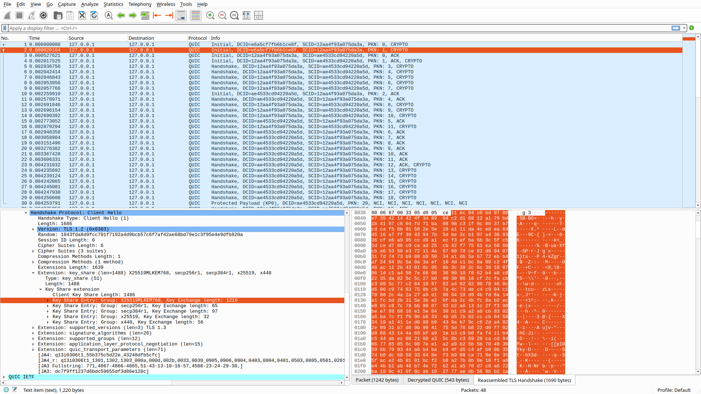

# ThreadLink

A QUIC comlink for agent swarms. Transport only.

**HyperSprint #1 · Track 1 (OmegaClaw Agents) · Team ThreadKeepers**

> We haven't invented another transport protocol. We're asking whether
> decentralized agents should take better advantage of one we already have.

ThreadLink moves framed messages between two agents over QUIC (RFC 9000) with
TLS 1.3 — mandatory encryption, one round trip to first byte, many independent
streams per connection, and a connection that survives the agent moving to a
different network. It knows nothing about routing, models, or OmegaClaw
internals: it is a skill any OmegaClaw agent (or any agent, full stop) can plug
in and define its own protocol on top of.

The first protocol that rides on it is **ThreadHello** — ThreadRouter agents
introducing themselves and trading learned FabricPC route tables. That lives
where it belongs, with the router:
**<https://github.com/hlgreenblatt/ThreadRouter>** (v0.2). If the route-sharing
idea goes nowhere, this comlink is still useful on its own — that separation is
the point, and it is enforced by the repo boundary: ThreadRouter imports
ThreadLink; ThreadLink imports nothing of ThreadRouter.

## Post-quantum by default (v0.4)

Every ThreadLink handshake is now post-quantum on both of its jobs:

- **Key agreement: `X25519MLKEM768`**, the hybrid of ML-KEM-768 (FIPS 203,
  the standardised CRYSTALS-Kyber) and X25519. Someone recording traffic today
  to decrypt it with a future quantum computer has to break *both*.
- **Identity: ML-DSA-65 certificates** (FIPS 204, the standardised
  CRYSTALS-Dilithium), and every CertificateVerify is an ML-DSA signature, on
  both sides, because ThreadLink is mutually authenticated. Most deployments
  that have adopted hybrid key exchange still sign with classical keys.

aioquic 1.3.0 supports neither, so `threadlink/pq.py` adds them using the ML-KEM
and ML-DSA that `cryptography` exposes from OpenSSL 3.5+. Every aioquic method it
replaces or wraps is fingerprinted. On any other aioquic version it patches
nothing, logs why, and ThreadLink keeps working classically
(`threadlink.pq_status()` reports which). Other details:

- `THREADLINK_PQ=off` is the rollback; `THREADLINK_PQ=require` refuses any peer
  that will not do the hybrid.
- A post-quantum node still talks to an older one (its classical key shares are
  offered behind the hybrid).
- `Peer.crypto` reports what a connection actually negotiated.
- Interop is checked against OpenSSL's own QUIC client: `openssl s_client -quic
  -groups X25519MLKEM768 -sigalgs mldsa65` with an ML-DSA client certificate
  completes the handshake against a ThreadLink listener.

The cost is bytes, not time. A 5.6 KB certificate and a 3.3 KB signature,
against roughly 0.5 KB for P-256, make the handshake about 10 KB larger. On
loopback it takes ~3.5 ms either way. See it on the wire in
[`demo/wireshark/pq/`](demo/wireshark/pq/): a decrypting capture plus screenshots.



---

## Why QUIC, concretely

| | TCP + TLS 1.3 | QUIC + TLS 1.3 |
|---|---|---|
| Round trips to first byte | 2 (3 with TLS 1.2) | **1**, or **0** resumed |
| Encryption | optional, bolted on | mandatory, integral |
| Head-of-line blocking | one byte pipe — a loss stalls everything behind it | per-stream — a stalled transfer stalls only itself |
| Survives an IP/port change | no, the connection *is* the four-tuple | **yes** — identified by Connection ID |

The last row is the interesting one for decentralized AGI. A QUIC connection is
identified by a Connection ID carried inside the packets, independent of the
addresses underneath, so it survives NAT rebinding and network changes. For
persistent agents that may move between machines, networks, edge devices and
compute providers, that property deserves attention — `demo/migration.py`
proves it live rather than asserting it.

## What the API looks like

```python
from threadlink import dial, listen, ensure_cert, Control

MY_MSG = 0x21          # your protocol's message types are yours to define

async def handle(msg_type, body, peer):        # server side
    if msg_type == MY_MSG:
        return MY_MSG, {"got": body}
    return Control.ERROR, {"error": "unhandled"}

cert, key = ensure_cert("certs", "agent_A", ["127.0.0.1"])
server = await listen(handle, "0.0.0.0", 4433, certfile=cert, keyfile=key)

async with await dial("192.168.86.41", 4433) as peer:   # client side
    reply_type, body = await peer.request(MY_MSG, {"hello": "world"})
    peer.migrate()                       # rotate Connection ID mid-session
```

Every `request` gets its own QUIC stream, so a large transfer never delays a
small urgent one — head-of-line isolation is structural, not something callers
must remember. The type byte is opaque to the transport; ThreadLink itself owns
only a handful of `Control` codes (PING/PONG/BYE/ERROR).

## Quick start

```bash
git clone https://github.com/hlgreenblatt/ThreadLink && cd ThreadLink
uv venv --python 3.11 .venv && uv pip install --python .venv/bin/python aioquic

./.venv/bin/python tests/test_threadlink.py   # 24 checks, incl. live QUIC
./.venv/bin/python demo/migration.py          # the agent moves, the link lives
./.venv/bin/python bench/handshake.py         # QUIC vs TCP+TLS, measured honestly
```

Or install it as a dependency of your own agent:

```bash
pip install git+https://github.com/hlgreenblatt/ThreadLink
```

Watch the wire while a demo runs (needs `CAP_NET_RAW`):

```bash
sudo tcpdump -i lo -n 'udp portrange 4433-4437'
# or in Wireshark, filter:  quic
```

## The benchmark is honest on purpose

`bench/handshake.py` runs on loopback, where QUIC's round-trip advantage is
worth ~0.05 ms, so it reports **measured** loopback numbers (where a C OpenSSL
TCP stack can beat pure-Python aioquic) separately from **projected**
round-trip arithmetic at a stated network RTT (where QUIC wins by construction:
1 RTT vs 2, or 0 resumed). Read the header of that file before quoting any
number.

## Security posture (sprint honesty)

Connections are always encrypted, post-quantum (see above); peer *authentication*
currently uses self-signed ML-DSA-65 certificates with verification off by default, suitable for a
trusted LAN and not beyond it — see `docs/SECURITY.md` for exactly what is and
is not defended, and the SPKI-pinning hook (`spki_pin`) left for the trust
layer to grow into.

## Layout

```
threadlink/link.py    dial/listen, streams, migration (aioquic underneath)
threadlink/wire.py    10-byte frame header + JSON body; type byte is opaque
threadlink/certs.py   per-agent self-signed certs (ML-DSA-65 default) + SPKI pins
threadlink/pq.py      X25519MLKEM768 + ML-DSA for aioquic 1.3.0
demo/migration.py     Connection ID rotates, session survives
bench/handshake.py    QUIC vs TCP+TLS 1.3, measured vs projected
tests/                42 checks: live QUIC round trip, post-quantum handshake,
                      fallback to a classical peer
```
